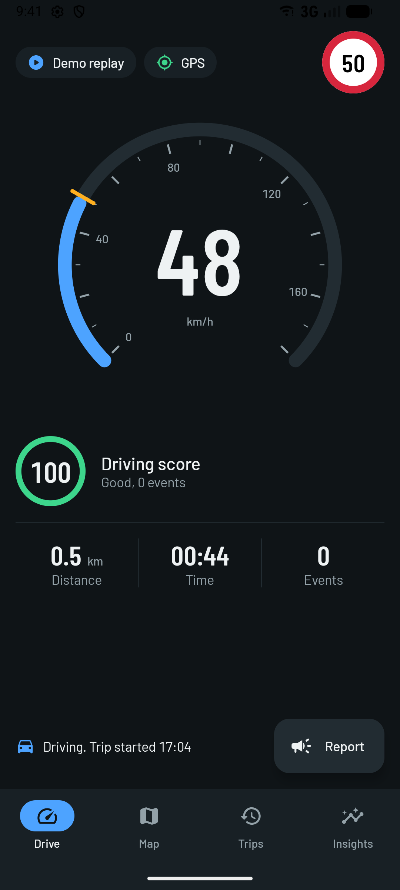

# DriveMetrics

## About

DriveMetrics is an Android app that turns a car's data into a live driving dashboard and a
driving score. It records trips automatically, shows where you lost points, estimates fuel and
money wasted by harsh driving, and compares you with a simulated benchmark driver.

- **Drive**: live speed, speed limit, score and trip status. Read-only.
- **Map**: the current route, or the last trip while parked.
- **Trips**: history with scores, and trip details with events, fuel estimate and tips.
- **Insights**: your score against a simulated benchmark, and fuel and money estimates.
- **Account**: sign in, sign up or try the demo; vehicle settings; crash alert demo.

Trips start and end by themselves from the car's data, so there is no start or end button.
For now the data comes from a built-in car simulator, so the whole app works without a car,
GPS or server. Fuel, money and benchmark values are estimates and are labelled as such.

<p>
  
  
  
  
</p>

## Tech stack

- Kotlin
- Jetpack Compose and Material 3
- Navigation Compose (type-safe routes)
- ViewModel, StateFlow and coroutines
- Kotlin serialization (for navigation routes)
- Gradle with a version catalog
- JUnit and Compose UI tests

## Project structure

```
gpstracker/
├── model/                  Plain data classes shared by all modules (JSON-ready)
├── telematics/             Vehicle tracker data format (AVL records) and its conversion
├── domain/                 Driving rules: events, score, trip detection
├── simulator/              A simulated car with a tracker, driving routes in Kaunas
├── app/                    The Android app
│   └── src/main/java/com/example/gpstracker/
│       ├── data/
│       │   ├── telematics/ Simulated data source and road map lookup
│       │   ├── drive/      Runs the driving rules and prepares data for the screens
│       │   ├── estimate/   Fuel estimate, benchmark, insights
│       │   ├── auth/       Account interface
│       │   └── fake/       Fake accounts, sample history, preview data
│       └── ui/
│           ├── theme/      Colors, fonts, shapes
│           ├── model/      Models the screens display
│           ├── components/ Reusable pieces: gauge, charts, cards, banners
│           ├── navigation/ Routes and bottom bar
│           └── auth, drive, map, trips, tripdetail, insights, settings, crash
└── docs/                   Screenshots and font license
```

Dependencies point one way: `app` uses `domain`, `telematics` and `simulator`;
`domain` and `telematics` use `model`; `model` uses nothing of ours. The driving rules
therefore never depend on Android, a device format or a screen.

Each screen has a stateless `Screen` composable, a `Route` that connects it to its
`ViewModel`, and a `ViewModel` that exposes one immutable state.

## Run the tests

Unit tests (no device needed):

```bash
./gradlew :model:test :telematics:test :domain:test :simulator:test :app:testDebugUnitTest
```

UI tests (an emulator or a phone must be connected):

```bash
./gradlew connectedDebugAndroidTest
```

## Run the app

Requirements: Android Studio (or JDK 17 and the Android SDK) and an emulator or a phone.

**Emulator**

1. Open the project in Android Studio and let Gradle sync.
2. Create a device in **Tools → Device Manager** and start it.
3. Choose it in the device dropdown and press **Run**.

**Physical phone**

1. On the phone: **Settings → About phone**, tap **Build number** 7 times, then turn on
   **USB debugging** in **Developer options**.
2. Connect it with a USB cable and accept the debugging prompt on the phone.
3. Check that `adb devices` lists it, then choose it in Android Studio and press **Run**.

**From a terminal** (with a device connected or an emulator running):

```bash
./gradlew installDebug
```

Then open **DriveMetrics**. Choose **Try the demo**, or sign in with
`demo@drivemetrics.app` / `demo1234`. A full demo loop takes about three minutes: the car
parks, a trip starts by itself, the car drives and the trip ends by itself.
