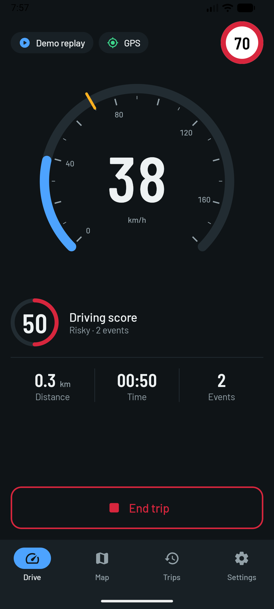
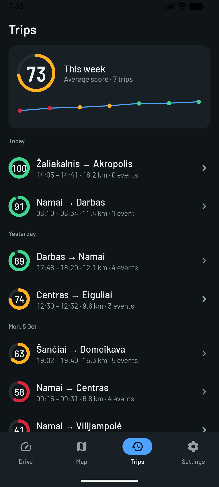
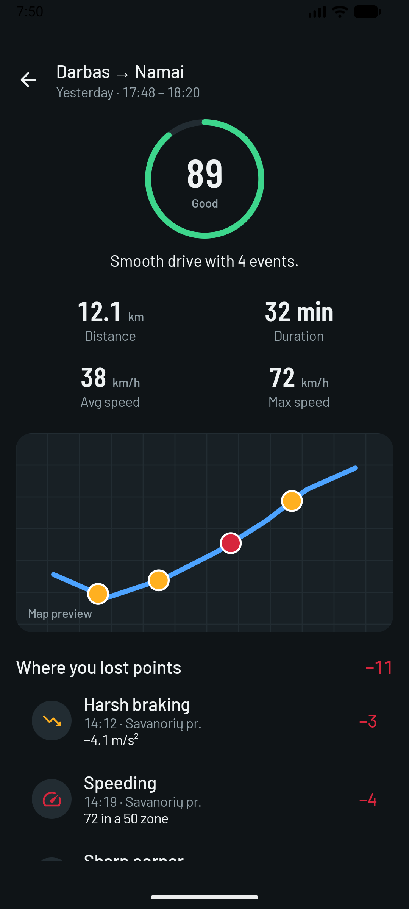
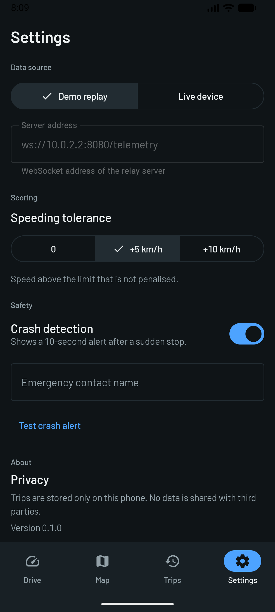

# DriveMetrics

An Android app that turns a car's telemetry (speed, position, acceleration) into a
live driving dashboard and a driving score. It is built **UI-first**: the screens run on
a built-in simulator, so the whole app can be demoed without a car, GPS or server.

<p>
  
  
  
  
</p>

## What it does

| Screen | What you see |
|---|---|
| **Drive** | Live speed gauge, speed limit sign, driving score, distance/time/events, start and end trip |
| **Map** | The route so far, event markers and the current position (drawn on a canvas, no API key) |
| **Trips** | Weekly average score, a sparkline and the history grouped by day |
| **Trip detail** | Score, stats, route with event markers, "where you lost points" and coaching tips |
| **Settings** | Data source, speeding tolerance, crash detection, emergency contact, privacy note |
| **Crash alert** | Full-screen 10-second countdown with "I'm OK" and "Send alert now" |

## Demo mode

On launch the simulator starts driving a looping route through Kaunas. Tap **Start trip** and
within about two minutes you will see speeding, an event banner, a reconnecting banner and a
GPS-lost banner. End the trip (hold the button for one second) and it appears in **Trips**.

## Project structure

```
gpstracker/
├── domain/   Pure Kotlin. Telemetry models, driving rules, no Android code.
└── app/      Android app: Jetpack Compose UI, ViewModels, fake data.
    └── ui/
        ├── theme/        Colors, fonts, shapes (dark only)
        ├── model/        UI models, already formatted for display
        ├── components/   Reusable pieces: gauge, sign, badges, chips, map
        ├── drive/ map/ trips/ tripdetail/ settings/ crash/
        │                 One folder per screen: Screen, Route and ViewModel
        └── navigation/   Routes, nav graph, bottom bar
```

### How the pieces talk

```
FakeDriveSimulator ──▶ ViewModel ──▶ Route ──▶ Screen
   (fake data)        (state)       (glue)    (pure UI)
```

- A **Screen** is stateless: it takes a `UiState` plus callbacks, and nothing else.
- A **Route** collects the ViewModel's `StateFlow` and passes it to the Screen.
- The **ViewModel** exposes the simulator's state and forwards button presses.
- Later the simulator is swapped for the real domain pipeline and no Screen changes.

## Tech

Kotlin, Jetpack Compose, Material 3, Navigation Compose (type-safe routes),
Kotlin coroutines and Flow. Barlow fonts (SIL OFL, see `docs/FONT_LICENSE.txt`).

## Build and run

Requirements: Android Studio (or JDK 17 and the Android SDK) and an emulator or phone.

```bash
./gradlew assembleDebug        # build
./gradlew installDebug         # install on the connected device or emulator
./gradlew :domain:test :app:testDebugUnitTest   # unit tests
./gradlew connectedDebugAndroidTest             # UI tests (device needed)
```

## Status

- Done: full UI, navigation, simulator, unit and UI tests.
- Next: real telemetry source (WebSocket), local database, real map, crash detection from data.

See `app/UI_SPEC.md` for the full UI specification.
