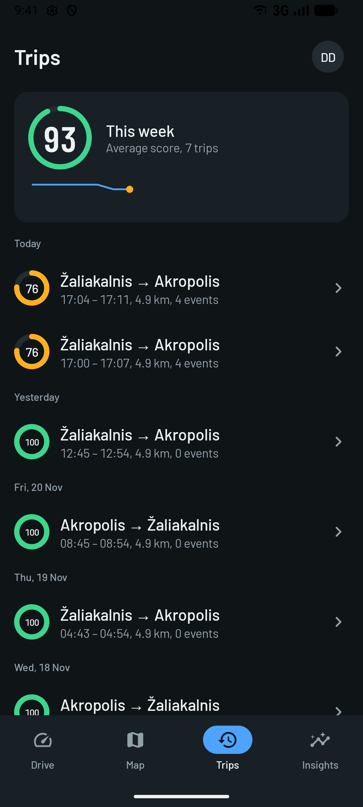
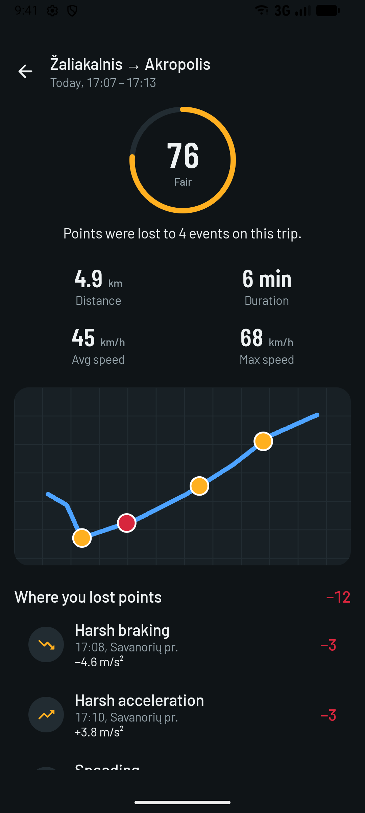
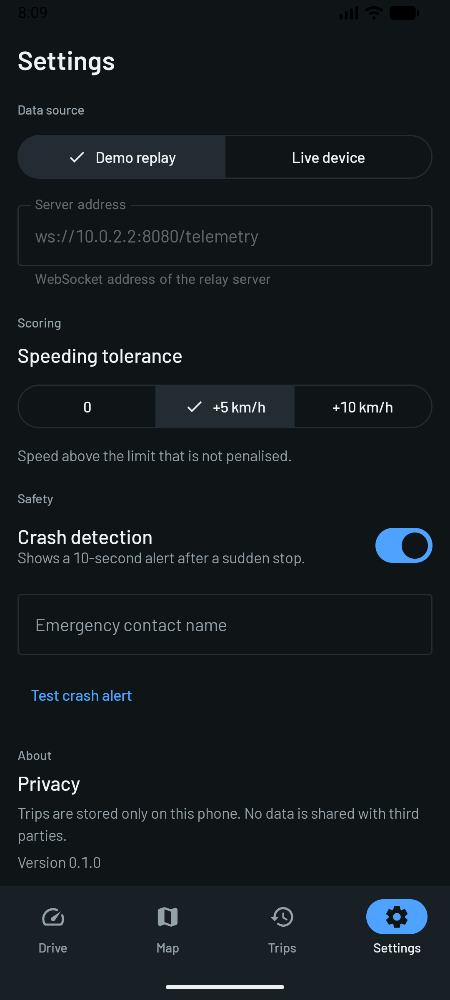

# DriveMetrics

[](https://github.com/akkamill/gpstracker/actions/workflows/ci.yml)

## About

DriveMetrics is an Android app that turns a car's data into a live driving dashboard and a
driving score. It records trips automatically, shows where you lost points, estimates fuel and
money wasted by harsh driving, and compares you with a simulated benchmark driver.

- **Drive**: live speed, speed limit, score and trip status. Read-only.
- **Map**: the current route, or the last trip while parked.
- **Trips**: history with scores, and trip details with events, fuel estimate and tips.
- **Insights**: your score against a simulated benchmark, and fuel and money estimates.
- **Account**: sign in, sign up or try the demo; vehicle settings; crash alert demo.

Trips start and end by themselves from the car's data, so there is no start or end button.
For now the data comes from a built-in car simulator, so the whole app works without a car,
GPS or server. Trips, road reports, accounts and settings are saved on the phone and are
still there after a restart. Fuel, money and benchmark values are estimates and are labelled
as such.

<p>
  
  
  
  
</p>

## Tech stack

- Kotlin
- Jetpack Compose and Material 3
- Navigation Compose (type-safe routes)
- ViewModel, StateFlow and coroutines
- Kotlin serialization (navigation routes and JSON models)
- Room (SQLite database) and DataStore (settings files) for saving data on the phone
- Koin for dependency injection
- Server: Ktor, PostgreSQL, Flyway migrations, JWT sign-in, run with Docker Compose
- Gradle with a version catalog
- JUnit, coroutine test helpers, Compose UI tests, Room tests on the device and
  PostgreSQL tests in Docker (Testcontainers)
- ktlint, detekt and Kover for code style, code checks and test coverage
- GitHub Actions for continuous integration

## Project structure

```
gpstracker/
├── tracing/                Internal logs and traces that follow one sample through all modules
├── model/                  Plain data classes shared by all modules (JSON-ready)
├── telematics/             Vehicle tracker data format (AVL records) and its conversion
├── domain/                 Driving rules: events, score, trip detection
├── simulator/              A simulated car with a tracker, driving routes in Kaunas
├── server/                 The project's server (Ktor + PostgreSQL), packed as a Docker image
├── app/                    The Android app
│   └── src/main/java/com/example/gpstracker/
│       ├── di/             Koin modules: which object is created where
│       ├── data/
│       │   ├── local/      Room database: tables, queries, saved trip history
│       │   ├── settings/   Settings saved with DataStore
│       │   ├── telematics/ Simulated data source and road map lookup
│       │   ├── tracing/    Sends traces to Logcat in debug builds
│       │   ├── drive/      Runs the driving rules and prepares data for the screens
│       │   ├── estimate/   Fuel estimate, benchmark, insights
│       │   ├── reports/    Road reports: warnings ahead, saving, votes
│       │   ├── auth/       Local accounts, password hashing, saved session
│       │   └── fake/       Demo trip history and preview data
│       └── ui/
│           ├── theme/      Colors, fonts, shapes
│           ├── model/      Models the screens display
│           ├── components/ Reusable pieces: gauge, charts, cards, banners
│           ├── navigation/ Routes and bottom bar
│           └── auth, drive, map, trips, tripdetail, insights, settings, crash
├── app/schemas/            Exported database schema of every version (for migrations)
├── compose.yaml            Starts PostgreSQL and the server in Docker on this computer
├── config/detekt/          Code check settings
└── docs/                   Screenshots and font license
```

Dependencies point one way: `app` uses `domain`, `telematics` and `simulator`;
`server` uses `domain` and `model`; `domain` and `telematics` use `model`; `model` uses
nothing of ours. The app and the server send each other the same `model` classes, and hash
passwords with the same code from `domain`. The driving rules
therefore never depend on Android, a device format or a screen. Every module may use
`tracing`, which depends on nothing of ours either.

Tracing is for developers only. Each tracker record starts a trace, and every module logs
its step under the same trace ID. In a debug build, open Logcat in Android Studio and
filter on `DM/` (or `DM/domain` for one module). Release builds write no logs.

Each screen has a stateless `Screen` composable, a `Route` that connects it to its
`ViewModel`, and a `ViewModel` that exposes one immutable state. Koin creates the
ViewModels and hands each one what it needs, so tests can pass in fakes instead.

### Saving data on the phone

| What | Where | Notes |
| --- | --- | --- |
| Trip history (route and events) | Room table `trips` and `trip_events` | Events are linked to their trip and deleted with it |
| Road reports | Room table `road_reports` | Expired and voted-away reports are removed |
| Accounts | Room table `accounts` | Passwords are only kept as salted PBKDF2 hashes |
| Settings and vehicle profile | DataStore file `settings` | |
| Who is signed in | DataStore file `session` | Only the email, never a password |

On the first start the history is filled with eight weeks of demo trips on the simulator's
routes, so Trips and Insights have something to show. The screens work with copies in
memory, and changes are written in the background, so saving never makes the app wait.
When a table changes, the database version goes up and a migration keeps the old data;
every version's schema is saved in `app/schemas`.

## Run the tests

Unit tests (no device needed):

```bash
./gradlew :tracing:test :model:test :telematics:test :domain:test :simulator:test :server:test :app:testDebugUnitTest
```

The server's database tests start a throwaway PostgreSQL in Docker. Without Docker running
they are skipped; on CI they always run.

UI and database tests (an emulator or a phone must be connected):

```bash
./gradlew connectedDebugAndroidTest
```

## Code quality

The same checks run on GitHub for every push (see the CI badge above).

```bash
./gradlew ktlintCheck      # code style; ./gradlew ktlintFormat fixes most of it
./gradlew detekt           # code smells and complexity
./gradlew koverHtmlReport  # test coverage of the pure-Kotlin modules
./gradlew koverVerify      # fails if that coverage is below 80 %
```

Reports are written to `build/reports/`. Style rules live in `.editorconfig`, code check
rules in `config/detekt/detekt.yml`; both explain each change from the defaults.

## Run the server

The server runs in Docker on your computer: one container for PostgreSQL, one for the server.
Requirements: Docker Desktop (running) and JDK 17.

```bash
./gradlew :server:installDist      # build the server
docker compose up --build -d       # start PostgreSQL and the server
curl http://localhost:8080/health  # {"status":"ok","database":"up"}
docker compose logs -f server      # follow the server's log
docker compose down                # stop; the data stays in the "db-data" volume
```

The emulator reaches your computer at `10.0.2.2`, so the app talks to `http://10.0.2.2:8080`.
The passwords in `compose.yaml` are for local development only; to use your own, copy
`.env.example` to `.env` and fill it in (`.env` is not committed). Tables are created and
updated by the numbered scripts in `server/src/main/resources/db/migration` when the server starts.

| Endpoint | What it does |
| --- | --- |
| `GET /health` | Is the server up, and can it reach the database? |
| `POST /api/auth/sign-up` | Creates an account (name, email, password); returns a token |
| `POST /api/auth/sign-in` | Returns a token for the right email and password |
| `GET /api/me` | The signed-in account; needs `Authorization: Bearer <token>` |

Errors always come back as `{"code": "...", "message": "..."}`, for example `email_taken`.

## Run the app

Requirements: Android Studio (or JDK 17 and the Android SDK) and an emulator or a phone.

**Emulator**

1. Open the project in Android Studio and let Gradle sync.
2. Create a device in **Tools → Device Manager** and start it.
3. Choose it in the device dropdown and press **Run**.

**Physical phone**

1. On the phone: **Settings → About phone**, tap **Build number** 7 times, then turn on
   **USB debugging** in **Developer options**.
2. Connect it with a USB cable and accept the debugging prompt on the phone.
3. Check that `adb devices` lists it, then choose it in Android Studio and press **Run**.

**From a terminal** (with a device connected or an emulator running):

```bash
./gradlew installDebug
```

Then open **DriveMetrics**. Choose **Try the demo**, or sign in with
`demo@drivemetrics.app` / `demo1234`. A full demo loop takes about three minutes: the car
parks, a trip starts by itself, the car drives and the trip ends by itself.
